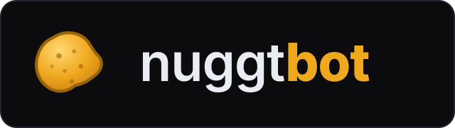

<p align="center">
  
</p>

<p align="center">
  A lightweight, headless re-implementation of <a href="https://streamer.bot">Streamer.bot</a> in Rust — for Linux and Windows.
</p>

---

## English

**nuggtbot** is a from-scratch, headless, Rust re-implementation of a Streamer.bot-style
live-stream automation bot. It has **no desktop GUI**: you configure everything from a
**web panel** in any browser on your network, and it runs as a single static binary
(systemd service on Linux, a plain executable on Windows). The goal is low RAM, no Wine,
no GUI — everything a stream bot does, reached through a web UI + WebSocket API instead of
a desktop window.

It integrates **Twitch, Kick and YouTube**: reads and sends chat, reacts to events (subs,
bits, raids, channel-point rewards), runs custom commands, timed messages, and visual
**overlays** and **browser docks** you drop into OBS as Browser Sources. It is extensible
through **drop-in native plugins** (see [`MAKE-PLUGINS.md`](MAKE-PLUGINS.md)).

### Why nuggtbot exists

> I tried several live-stream bots, but none of them really had the features I needed. I
> used to run Streamer.bot, but what I actually wanted was a bot for **Linux streaming**
> with a **web interface** where I — and my moderators — could configure everything. This
> is no disrespect to the Streamer.bot team or to other similar projects: what those people
> built, and the help it has given to thousands of streamers, is undeniable, and it would be
> ignorant to belittle such excellent work. It simply did not fit my needs. So I present to
> you **nuggtbot**.

### Features

- **Platforms** — Twitch, Kick, YouTube: read/send chat, events (follow, sub/resub/gift,
  cheer/bits, raid, channel-point rewards, stream online/offline).
- **Commands** — custom chat commands (trigger → Action), cooldowns (global/user),
  role-based permissions, aliases, cost.
- **Actions & sub-actions** — an Action is an ordered list of sub-actions: send message,
  delay, variables, conditions/loops, HTTP request, OBS, VTube Studio, play sound/TTS,
  run another Action, and more.
- **Timers** — send a message to the chosen chats (Twitch/Kick/YouTube), from the bot or
  broadcaster account, every N seconds.
- **Overlays & docks** — a chat overlay (public, on stream), plus browser docks for OBS:
  chat moderation, an events feed, and a stream-info editor. Plugins can serve their own.
- **Integrations** — OBS, VTube Studio, Throwing System (T.I.T.S.), Discord webhooks,
  Streamlabs/StreamElements, and more.
- **Plugins** — drop a native `.so`/`.dll` into `plugins/` to add actions and pages,
  without recompiling the bot.

### How it works

- Single `tokio` async process, headless daemon.
- `axum` serves the web panel (SPA), a REST API, and a WebSocket/SSE event + chat feed.
- A `tokio::sync::broadcast` event bus carries platform events to the Action engine, which
  matches triggers and runs Actions.
- Persistence is a JSON file store; secrets live in a gitignored `secrets.json`.

### Running it

```sh
# Build (Linux or Windows; needs a Rust toolchain)
cargo build --release

# Copy the example config and edit it
cp config.toml.example config.toml

# Run
./target/release/nuggtbot          # Linux
# target\release\nuggtbot.exe      # Windows
```

The panel is then reachable at the bound address (default `127.0.0.1:7777`). Open it in a
browser to configure accounts, commands, timers, integrations and overlays.

### ⚠️ YouTube — current limitations

YouTube support uses the **YouTube Data API v3**, and **nuggtbot ships with no
registered/verified API app of its own**. To use YouTube you must create **your
own** Google Cloud OAuth client (Client ID + Secret) and set it in the panel
(Accounts tab), registering your panel's `.../auth/youtube/callback` as the
redirect URI (Google only accepts `https://` or `http://localhost`).

Because that OAuth app stays in Google's **testing** mode (unverified), Google
expires the **refresh token every 7 days** — so the YouTube connection drops and
you must log in again roughly once a week. Twitch and Kick are not affected. If
no YouTube live is open, YouTube chat actions are simply skipped.

### ⚠️ Security

The web panel has **no authentication** and is only safe **behind a private network such as
[Tailscale](https://tailscale.com)**. Do **not** expose it with a Tailscale Funnel, and do
**not** bind `0.0.0.0` on an untrusted network. `secrets.json`, `config.toml`, `data.json`,
`overlay.json`, `backups/` and the plugin binaries are gitignored — never commit them.
A plugin is **unsandboxed native code** running with the bot's privileges: only load a
`.so`/`.dll` you built yourself or fully trust.

### Documentation

- [`MAKE-PLUGINS.md`](MAKE-PLUGINS.md) — how to build plugins (actions, config, overlays/docks).
- [`ARCHITECTURE.md`](ARCHITECTURE.md) — target architecture and the Streamer.bot function catalog.
- [`PLAN.md`](PLAN.md) — the full build plan and roadmap.
- [`SB_PARITY.md`](SB_PARITY.md) — the nuggtbot ↔ Streamer.bot parity map.

---

## Português (Brasil)

**nuggtbot** é uma reimplementação do zero, headless, em Rust, de um bot de automação de
lives no estilo do Streamer.bot. Ele **não tem interface gráfica de desktop**: você
configura tudo por um **painel web** em qualquer navegador da sua rede, e ele roda como um
único binário estático (serviço systemd no Linux, executável comum no Windows). O objetivo
é baixo consumo de RAM, sem Wine, sem GUI — tudo que um bot de live faz, acessado por uma UI
web + API WebSocket em vez de uma janela de desktop.

Ele integra **Twitch, Kick e YouTube**: lê e envia chat, reage a eventos (subs, bits, raids,
resgates de pontos de canal), roda comandos personalizados, mensagens automáticas por tempo,
e **overlays** e **browser docks** visuais que você coloca no OBS como Browser Source. É
extensível por **plugins nativos plug-and-play** (veja [`MAKE-PLUGINS.md`](MAKE-PLUGINS.md)).

### Por que o nuggtbot existe

> Testei alguns bots para lives, mas nenhum tinha de fato as funções que eu queria. Antes eu
> usava o Streamer.bot, mas a minha necessidade era um bot para **lives no Linux** com uma
> **interface web** onde eu — e meus moderadores também — pudesse configurar o bot. Isso não
> é desmerecer o trabalho feito por várias pessoas da equipe do Streamer.bot ou de outros
> projetos similares, porque o que eles conseguiram fazer, e a ajuda que deram a milhares de
> pessoas, é inegável, e seria ignorância menosprezar o excelente trabalho dessas pessoas.
> Mas, infelizmente, não supriam as minhas necessidades. Por isso eu apresento a vocês o
> **nuggtbot**.

### Funcionalidades

- **Plataformas** — Twitch, Kick, YouTube: ler/enviar chat, eventos (follow, sub/resub/gift,
  cheer/bits, raid, resgate de pontos de canal, live online/offline).
- **Comandos** — comandos de chat personalizados (gatilho → Action), cooldowns (global/usuário),
  permissões por cargo, aliases, custo.
- **Actions e sub-actions** — uma Action é uma lista ordenada de sub-actions: enviar mensagem,
  delay, variáveis, condições/loops, requisição HTTP, OBS, VTube Studio, tocar som/TTS, rodar
  outra Action, e mais.
- **Timers** — enviar uma mensagem nos chats escolhidos (Twitch/Kick/YouTube), pela conta do
  bot ou do broadcaster, a cada N segundos.
- **Overlays e docks** — um overlay de chat (público, na live), além de browser docks para o
  OBS: moderação de chat, feed de eventos e editor de info da live. Plugins podem servir os
  seus próprios.
- **Integrações** — OBS, VTube Studio, Throwing System (T.I.T.S.), webhooks do Discord,
  Streamlabs/StreamElements, e mais.
- **Plugins** — largue um `.so`/`.dll` nativo em `plugins/` para adicionar ações e páginas,
  sem recompilar o bot.

### Como funciona

- Um único processo assíncrono `tokio`, daemon headless.
- `axum` serve o painel web (SPA), uma API REST e um feed de eventos + chat via WebSocket/SSE.
- Um barramento de eventos `tokio::sync::broadcast` leva os eventos das plataformas ao motor
  de Actions, que casa os gatilhos e executa as Actions.
- A persistência é um arquivo JSON; os segredos ficam num `secrets.json` gitignored.

### Executando

```sh
# Compilar (Linux ou Windows; precisa do toolchain do Rust)
cargo build --release

# Copiar o config de exemplo e editar
cp config.toml.example config.toml

# Rodar
./target/release/nuggtbot          # Linux
# target\release\nuggtbot.exe      # Windows
```

O painel fica acessível no endereço configurado (padrão `127.0.0.1:7777`). Abra no navegador
para configurar contas, comandos, timers, integrações e overlays.

### ⚠️ YouTube — limitações atuais

O suporte ao YouTube usa a **YouTube Data API v3**, e o **nuggtbot não vem com uma
API registrada/verificada própria**. Para usar o YouTube você precisa criar a
**sua própria** OAuth client no Google Cloud (Client ID + Secret) e configurá-la
no painel (aba Accounts), registrando o `.../auth/youtube/callback` do seu painel
como redirect URI (o Google só aceita `https://` ou `http://localhost`).

Como esse app OAuth fica em modo **testing** (não verificado) no Google, o Google
expira o **refresh token a cada 7 dias** — então a conexão com o YouTube cai e você
precisa logar de novo cerca de uma vez por semana. Twitch e Kick não são afetados.
Se não houver live do YouTube aberta, as ações de chat do YouTube são apenas
ignoradas.

### ⚠️ Segurança

O painel web **não tem autenticação** e só é seguro **atrás de uma rede privada como a
[Tailscale](https://tailscale.com)**. **Não** exponha por Tailscale Funnel e **não** faça
bind em `0.0.0.0` em rede não confiável. `secrets.json`, `config.toml`, `data.json`,
`overlay.json`, `backups/` e os binários de plugin são gitignored — nunca os comite.
Um plugin é **código nativo sem sandbox** rodando com os privilégios do bot: só carregue um
`.so`/`.dll` que você mesmo compilou ou confia totalmente.

### Documentação

- [`MAKE-PLUGINS.md`](MAKE-PLUGINS.md) — como criar plugins (ações, config, overlays/docks).
- [`ARCHITECTURE.md`](ARCHITECTURE.md) — arquitetura-alvo e o catálogo de funções do Streamer.bot.
- [`PLAN.md`](PLAN.md) — o plano de build completo e o roadmap.
- [`SB_PARITY.md`](SB_PARITY.md) — o mapa de paridade nuggtbot ↔ Streamer.bot.
